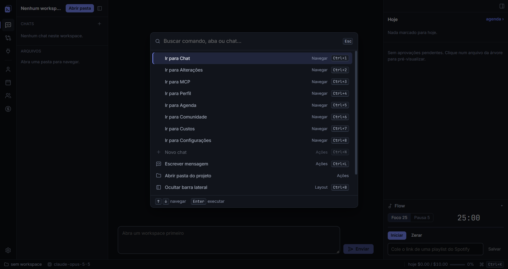
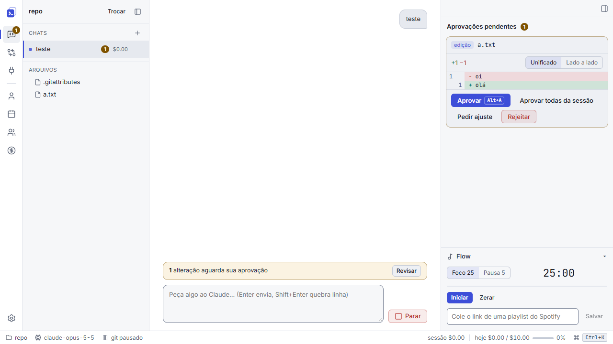

# DevDeck

**English** · [Português](README.pt-BR.md)

DevDeck is a local cockpit for developers. It brings vibe coding with Claude, MCP servers, reviewable diffs, AI cost tracking, your git activity across platforms, achievements, your daily agenda and a community feed together in one desktop app.

Stack: Electron 45 · electron-vite 6 · React 19 · TypeScript · zustand · Claude Agent SDK · MCP SDK · Supabase · ical.js · lucide · Inter / JetBrains Mono





## Features

| Area | What you get |
|---|---|
| **Chat** | One Claude Agent SDK session per chat, scoped to a workspace. Streaming replies, local history, resume and stop. Attach files with `@` from the file tree. |
| **Reviewable diffs** | `Edit`/`Write`/`Bash`/MCP tool calls stop in an approval panel with unified or side-by-side diffs. You can approve, approve all for the session, ask for changes (your comment goes back to Claude) or reject. Each applied change can be reverted with a reverse patch. |
| **MCP panel** | stdio, HTTP or SSE servers. Toggle them, test the connection, set an auto/ask policy per tool, and import servers from Claude Desktop or Claude Code. |
| **Costs** | Per turn, session, day, month and model, with cache tokens. Daily and per-session budgets, plus a context-usage meter. |
| **Profile** | GitHub, GitLab (cloud or self-hosted) and Bitbucket Cloud metrics from read-only personal tokens: commits, PRs, reviews, streaks, a 26-week heatmap, languages and top repositories. |
| **Achievements** | 31 achievements across AI, Git, Focus, Agenda and Community, with XP, levels and up to 3 featured badges. |
| **Agenda** | Recurring local events (with a one-click daily stand-up), reminders with a Join button, and read-only ICS subscriptions (Outlook/Google). |
| **Community** | Articles and code snippets on Supabase, with likes, comments and reports. Access is enforced by row-level security. |
| **Flow** | Spotify embed and a 25/5 focus timer. |
| **Keyboard first** | `Ctrl+K` command palette (tabs, chats, actions, fuzzy search), `Ctrl+1–8` to switch tabs, `Ctrl+N` new chat, `Ctrl+L` focus the prompt, `Ctrl+B` / `Ctrl+Alt+B` toggle the side panels, `Ctrl+/` or `F1` lists every shortcut. Approve or reject the focused change with `Alt+A` / `Alt+R`. |
| **Layout** | "Indigo Night" theme in dark and light (or follow Windows), built on design tokens (AA contrast checked by tests), collapsible sidebar, resizable and collapsible right panel that stays open while an approval is pending. |

## Install (Windows)

Download `DevDeck-Setup-<version>.exe` and `SHA256SUMS.txt` from the [Releases](https://github.com/flavsjr/devdeck/releases) page. The installer is per-user: no admin rights and no UAC prompt. Your data stays in `%APPDATA%\DevDeck` and is kept on update and uninstall. There is no auto-update.

**Windows may say "Windows protected your PC".** The installer is not code-signed yet. Before clicking *More info → Run anyway*, check the hash:

```powershell
Get-FileHash .\DevDeck-Setup-0.5.0.exe -Algorithm SHA256
```

The value must match the installer's line in `SHA256SUMS.txt` from the same release. If it differs, do not install it and open an issue. To confirm the file was built by this repository's CI (optional):

```powershell
gh attestation verify .\DevDeck-Setup-0.5.0.exe --repo flavsjr/devdeck
```

## Run from source

```powershell
npm install
npm run dev
```

If Electron reports a missing binary, run `node node_modules/electron/install.js`.

- **Claude:** open *Config → Authentication* and paste an Anthropic API key. It is encrypted with the OS keychain via `safeStorage`.
- **Community (optional):** create a Supabase project and run the migrations in [`supabase/migrations/`](supabase/migrations/) in order (`0001`, `0002`). Add `{{ .Token }}` to the Magic Link email template, then copy `.env.example` to `.env`. Use the publishable/anon key only, never the `service_role` key.
- **Git providers:** in *Profile → Connections*, paste a read-only token for each provider you use.

Other scripts: `npm run typecheck`, `npm test` (Vitest, runs in two time zones), `npm run test:coverage`, `npm run build`, `npm start`, `npm run test:e2e` (Playwright end-to-end on the Electron app), `npm run pack:win` (unpacked app in `dist/win-unpacked`) and `npm run dist:win` (installer). CI runs typecheck, tests, build and a secret scan on every push and PR.

### Security model

- Only the DevDeck UI can call the main process, and every argument is validated (zod). Navigation, new windows and browser permissions are denied by default.
- Project settings (`.claude/settings.json`, `.mcp.json`) are **off by default**. When enabled, DevDeck lists the hooks, permissions and MCP servers a repository wants to run and only loads them after you trust the workspace. It asks again if those files change.
- Every shell command the agent runs (Bash or PowerShell) stops for approval, including the ones Claude Code treats as read-only, such as `git status`.
- The agent only gets the tools the approval card knows how to show (read, search, edit, write, shell, web search, subagent). Your claude.ai connectors are not loaded in DevDeck's chat; MCP servers come only from DevDeck or a trusted project `.mcp.json`.
- "Approve all for this session" never applies outside the workspace or to `.git`, `.claude`, `.vscode`, `.github` and similar folders.
- MCP environment variables and headers, ICS links, git tokens and the API key are encrypted with the OS keychain. The UI only ever sees a mask, and a stored secret is never reused for a different server target.
- Trusting a workspace also covers every file under `.claude/` (skills, commands, agents); links there make DevDeck ask every time.
- **Git never runs repository-configured programs before you trust them.** If `.git/config` has anything beyond plain data (fsmonitor, filters, textconv, hooks path, includes…) or `.git` points elsewhere, or `.gitmodules` sets a submodule `ignore` other than `all`, or `.git/hooks` has a hook (anything but `*.sample`), git is paused for that workspace, including git run by the agent. A `core.worktree` outside the workspace root, or an `include.path` pointing outside `.git`, blocks git with no option to trust. Even in a trusted repository, DevDeck runs git by absolute path with fsmonitor and hooks disabled, and neither DevDeck nor the agent steps into submodules.
- "Always this session" only applies to paths inside the workspace; tool calls that touch other paths ask every time.
- MCP server URLs carrying a token in the query string are refused: put credentials in a header.
- The installed app ships with Electron fuses that block `ELECTRON_RUN_AS_NODE`, `NODE_OPTIONS` and `--inspect`, verifies the asar integrity and refuses remote debugging switches.

## How we work

DevDeck is built by a **squad** (PO, Tech Lead, UX, Frontend, Backend, QA, Cybersecurity, DevOps). Each role is a Claude Code subagent in [`.claude/agents/`](.claude/agents/). Work happens in sprints:

- Process and the debate format: [`docs/squad.md`](docs/squad.md)
- Sprints: [`docs/sprints/`](docs/sprints/)
- Architecture decisions: [`docs/decisions.md`](docs/decisions.md)
- Release notes: [`CHANGELOG.md`](CHANGELOG.md)

## Project layout

```
src/
  shared/      IPC contracts, achievement catalog
  main/        Electron main: agent, MCP, providers, profile, achievements, agenda, store
  preload/     window.deck bridge (contextBridge)
  renderer/    React UI
supabase/      community schema + RLS
tests/         Vitest unit tests (pure logic in src/**/lib)
.github/       CI workflow + Dependabot
docs/          squad, sprints, ADRs
```

Local data lives in `%APPDATA%/DevDeck`.

## Contributing, security and license

- How to contribute: [CONTRIBUTING.md](CONTRIBUTING.md)
- Report vulnerabilities privately: [SECURITY.md](SECURITY.md)
- License: [MIT](LICENSE)
