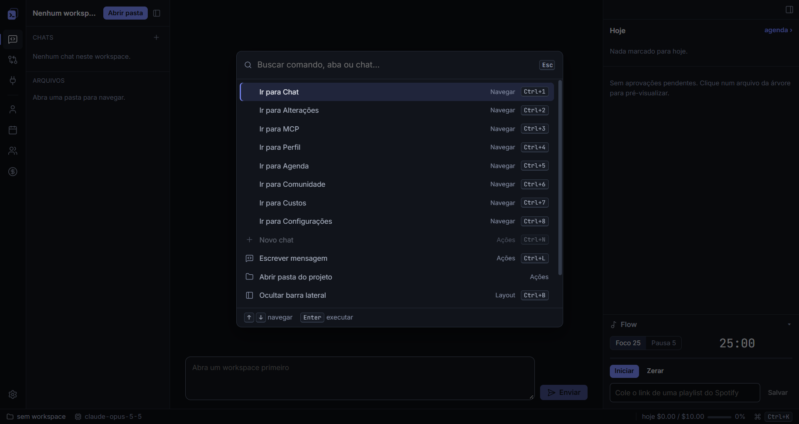
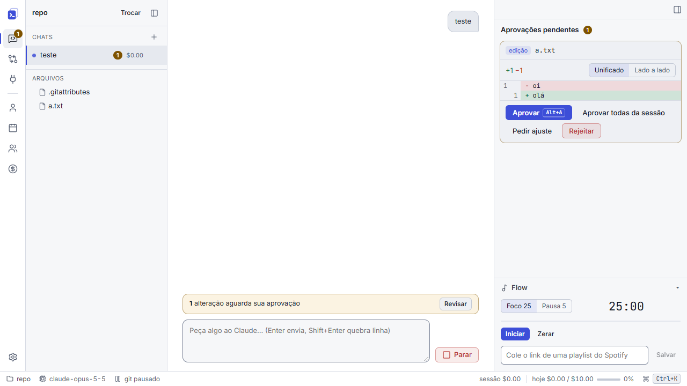

# DevDeck

[English](README.md) · **Português**

O DevDeck é o cockpit local do dev. Num único app desktop, ele junta vibe coding com o Claude, servidores MCP, diffs revisáveis, controle de custo de IA, sua atividade git em várias plataformas, conquistas, a agenda do dia e um feed da comunidade.

Stack: Electron 45 · electron-vite 6 · React 19 · TypeScript · zustand · Claude Agent SDK · MCP SDK · Supabase · ical.js · lucide · Inter / JetBrains Mono





## Funcionalidades

| Área | O que tem |
|---|---|
| **Chat** | Uma sessão do Claude Agent SDK por chat, presa a um workspace. Respostas em streaming, histórico local, retomada e botão Parar. Anexe arquivos com `@` na árvore. |
| **Diff revisável** | Chamadas de `Edit`/`Write`/`Bash`/tools MCP param num painel de aprovação, com diff unificado ou lado a lado. Dá para aprovar, aprovar todas da sessão, pedir ajuste (o comentário volta ao Claude) ou rejeitar. Cada alteração aplicada pode ser revertida por patch reverso. |
| **Painel MCP** | Servidores stdio, HTTP ou SSE. Ligue e desligue, teste a conexão, defina a política auto/pedir por tool e importe do Claude Desktop ou do Claude Code. |
| **Custos** | Por turno, sessão, dia, mês e modelo, incluindo tokens de cache. Teto diário e por sessão, além de medidor de contexto. |
| **Perfil** | Métricas de GitHub, GitLab (cloud ou self-hosted) e Bitbucket Cloud via token pessoal de leitura: commits, PRs, reviews, sequência, heatmap de 26 semanas, linguagens e repositórios mais ativos. |
| **Conquistas** | 31 conquistas em IA, Git, Foco, Agenda e Comunidade, com XP, níveis e até 3 destaques. |
| **Agenda** | Eventos locais recorrentes (com atalho de daily), lembretes com botão Entrar e assinatura ICS somente leitura (Outlook/Google). |
| **Comunidade** | Artigos e snippets no Supabase, com curtidas, comentários e denúncias. O acesso é controlado por row-level security. |
| **Flow** | Embed do Spotify e timer de foco 25/5. |
| **Teclado primeiro** | Paleta de comandos `Ctrl+K` (abas, chats e ações, com busca aproximada), `Ctrl+1–8` troca de aba, `Ctrl+N` novo chat, `Ctrl+L` foca a mensagem, `Ctrl+B` / `Ctrl+Alt+B` mostram e ocultam os painéis, `Ctrl+/` ou `F1` lista todos os atalhos. Aprove ou rejeite a alteração focada com `Alt+A` / `Alt+R`. |
| **Layout** | Tema "Índigo Noturno" escuro e claro (ou seguindo o Windows), com design tokens (contraste AA conferido por teste), barra lateral recolhível e painel direito redimensionável e recolhível, que fica aberto enquanto houver aprovação pendente. |

## Instalar (Windows)

Baixe `DevDeck-Setup-<versão>.exe` e `SHA256SUMS.txt` na página de [Releases](https://github.com/flavsjr/devdeck/releases). O instalador é por usuário: não pede admin nem mostra UAC. Seus dados ficam em `%APPDATA%\DevDeck` e são mantidos ao atualizar e ao desinstalar. Não há atualização automática.

**O Windows pode avisar "O Windows protegeu o computador".** O instalador ainda não é assinado. Antes de clicar em *Mais informações → Executar assim mesmo*, confira o hash:

```powershell
Get-FileHash .\DevDeck-Setup-0.5.0.exe -Algorithm SHA256
```

O valor tem que ser igual à linha do instalador em `SHA256SUMS.txt` da mesma release. Se for diferente, não instale e abra uma issue. Para conferir que o arquivo saiu do CI deste repositório (opcional):

```powershell
gh attestation verify .\DevDeck-Setup-0.5.0.exe --repo flavsjr/devdeck
```

As notas de cada release também trazem o link do relatório do instalador no VirusTotal (a partir da v0.7.0). O instalador enviado ao VirusTotal fica público lá.

## Rodar pelo código-fonte

```powershell
npm install
npm run dev
```

Se o Electron reclamar de binário ausente, rode `node node_modules/electron/install.js`.

- **Claude:** em *Config → Autenticação*, cole uma chave da API Anthropic. Ela fica criptografada no cofre do sistema via `safeStorage`.
- **Comunidade (opcional):** crie um projeto no Supabase e rode as migrations de [`supabase/migrations/`](supabase/migrations/) em ordem (`0001`, `0002`). Inclua `{{ .Token }}` no template de e-mail Magic Link e copie `.env.example` para `.env`. Use só a chave publishable/anon, nunca a `service_role`.
- **Provedores git:** em *Perfil → Conexões*, cole um token de leitura para cada provedor que você usa.

Outros scripts: `npm run typecheck`, `npm test` (Vitest, roda em dois fusos), `npm run test:coverage`, `npm run build`, `npm start`, `npm run test:e2e` (ponta a ponta com Playwright no app Electron), `npm run pack:win` (app sem instalador em `dist/win-unpacked`) e `npm run dist:win` (instalador). O CI roda typecheck, testes, build e varredura de segredos em todo push e PR.

### Modelo de segurança

- Só a interface do DevDeck chama o processo principal, e todo argumento é validado (zod). Navegação, janelas novas e permissões do navegador são negadas por padrão.
- Configurações do projeto (`.claude/settings.json`, `.mcp.json`) vêm **desligadas**. Quando ligadas, o DevDeck lista os hooks, permissões e servidores MCP que o repositório quer executar e só carrega depois que você confia no workspace. Se esses arquivos mudarem, ele pergunta de novo.
- Todo comando de shell do agente (Bash ou PowerShell) para no card de aprovação, inclusive os que o Claude Code trata como só-leitura, como `git status`.
- O agente só recebe as ferramentas que o card de aprovação sabe mostrar (ler, buscar, editar, escrever, shell, busca na web, subagente). Os conectores da sua conta do claude.ai não carregam no chat do DevDeck; servidores MCP vêm só do DevDeck ou do `.mcp.json` de um projeto confiado.
- "Aprovar todas da sessão" nunca vale fora do workspace nem em `.git`, `.claude`, `.vscode`, `.github` e pastas parecidas.
- Variáveis e headers de MCP, links ICS, tokens git e a chave da API ficam cifrados no cofre do sistema. A interface só vê uma máscara, e um segredo guardado nunca é reaproveitado para outro destino.
- Confiar num workspace cobre também os arquivos de `.claude/` (skills, comandos, agentes); se houver links ali, o DevDeck pergunta toda vez.
- **O git nunca roda programas configurados pelo repositório antes de você confiar.** Se o `.git/config` tiver algo além de dados simples (fsmonitor, filtros, textconv, pasta de hooks, includes…) ou o `.git` apontar para outro lugar, ou o `.gitmodules` marcar um submódulo com `ignore` diferente de `all`, ou o `.git/hooks` tiver um hook (qualquer coisa menos `*.sample`), o git fica pausado naquele workspace, inclusive o git do agente. Um `core.worktree` fora da raiz do workspace, ou um `include.path` apontando para fora do `.git`, bloqueia o git sem opção de confiar. Mesmo num repositório confiado, o DevDeck roda o git por caminho absoluto, com fsmonitor e hooks desligados, e nem o DevDeck nem o agente entram em submódulos.
- "Sempre nesta sessão" só vale para caminhos dentro do workspace; ferramentas que tocam outros caminhos perguntam toda vez.
- URL de servidor MCP com token na query é recusada: coloque a credencial num header.
- O app instalado vem com fuses do Electron que bloqueiam `ELECTRON_RUN_AS_NODE`, `NODE_OPTIONS` e `--inspect`, confere a integridade do asar e recusa os switches de depuração remota.

## Como trabalhamos

O DevDeck é construído por um **squad** (PO, Tech Lead, UX, Frontend, Backend, QA, Cybersecurity, DevOps). Cada papel é um subagente do Claude Code em [`.claude/agents/`](.claude/agents/). O trabalho acontece em sprints:

- Processo e formato do debate: [`docs/squad.md`](docs/squad.md)
- Sprints: [`docs/sprints/`](docs/sprints/)
- Decisões de arquitetura: [`docs/decisions.md`](docs/decisions.md)
- Notas de versão: [`CHANGELOG.md`](CHANGELOG.md)

## Estrutura

```
src/
  shared/      contratos IPC, catálogo de conquistas
  main/        main do Electron: agente, MCP, provedores, perfil, conquistas, agenda, store
  preload/     ponte window.deck (contextBridge)
  renderer/    interface React
supabase/      schema da comunidade + RLS
tests/         testes unitários Vitest (lógica pura em src/**/lib)
.github/       workflow de CI + Dependabot
docs/          squad, sprints, ADRs
```

Os dados locais ficam em `%APPDATA%/DevDeck`.

## Contribuição, segurança e licença

- Como contribuir: [CONTRIBUTING.md](CONTRIBUTING.md)
- Reporte vulnerabilidades de forma privada: [SECURITY.md](SECURITY.md)
- Licença: [MIT](LICENSE)
